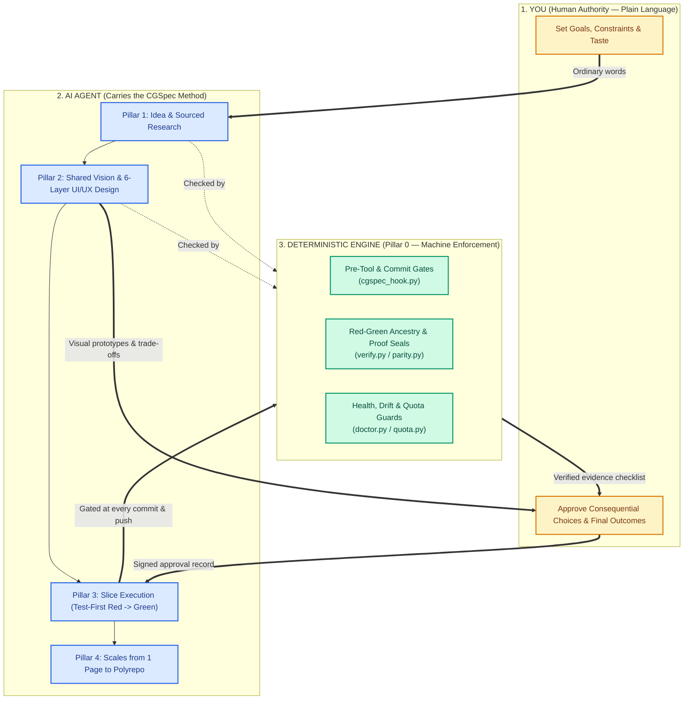
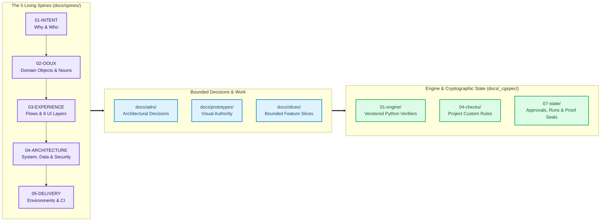

# CGSpec
Created: unknown · Last edited: 2026-10-31T20:15:00Z

[](CHANGELOG.md)
[](engine/)
[](plugin.json)
[](docs/METHOD.md#8-enforcement-engine)

**Deterministic Spec-Driven Software Engineering for AI Agents.**

When building software with AI coding agents, projects frequently degrade as they grow: agents forget earlier architectural choices, silently alter scope, claim tests passed without running them, or ship user interfaces that drift from the approved design.

**CGSpec solves this through a strict division of labor:**
1. **You speak in ordinary language:** You set goals, constraints, and taste, and approve consequential choices. You never need to memorize the method.
2. **The agent carries the method:** It maps what exists, brings sourced evidence and design references, maintains living architecture records, slices the work, writes failing tests before code, and records gaps honestly.
3. **Deterministic scripts enforce the rules:** Every rule that a machine can verify is enforced by local Git/tool hooks and CI (`engine/`) — never left to an AI's goodwill. Human judgment stays with you.

> [!IMPORTANT]
> The canonical [Method Specification](docs/METHOD.md) defines the full contract, repository layout, 6-layer UI/UX design path, review rules, adoption flow, and limits. [Implementation Status](docs/STATUS.md) separates implemented engine checks from outcomes that still require live proof.

---

## How CGSpec Works (The 5 Pillars)



| Pillar | What It Guarantees |
| --- | --- |
| **0 — Deterministic Feedback** | The agent turns checkable rules into scripts under `docs/_cgspec/04-checks/` and runs them on every change. AI judgment is used only for what no script can measure. |
| **1 — Idea & Research** | Identifies goal type first (`money`, `learning`, `personal`, `client`). A commercial goal requires a sourced market research record before design begins. |
| **2 — Shared Vision & Design** | The agent leads with up to 6 real design references, helps articulate taste, and walks a fixed 6-layer UI path from user tasks to motion before coding. |
| **3 — Build (Test-First)** | Requires a failing test commit (`RED`) before implementation (`GREEN`), small single-purpose files, and zero duplicated logic (DRY). |
| **4 — Any Size** | Scales uniformly from a single-page site to a multi-service polyrepo while keeping each repository independent. |

---

## Why CGSpec? (Ungoverned AI vs. CGSpec Governance)

| Dimension | Ungoverned AI Coding | With CGSpec |
| --- | --- | --- |
| **Project Memory** | Lost across chat sessions; repeated prompting | Versioned in **5 Living Spines**, **ADRs**, and a structured state ledger |
| **Test Discipline** | Tests written after code, mocked away, or skipped | Enforced **Red -> Implementation -> Green** Git commit ancestry |
| **UI / UX Quality** | Generic layouts and silent visual regressions | Approved HTML prototypes + **Playwright visual parity** (`desktop`/`mobile`, `light`/`dark`) |
| **Code Review** | Same agent grades its own homework | **Independent cross-model review** + outcome-based human closure checklist |
| **Safety & Scope** | Accidental `git reset --hard`, leaked secrets, out-of-scope edits | **Pre-tool & pre-commit gates** block destructive Git, secrets, emojis, and unapproved scope |

---

## Repository Architecture: The 5 Spines & Engine State

When CGSpec is installed into a project, it structures architectural knowledge and machine verification into three clear zones:



---

## Deterministic Slice Lifecycle (`cgspec-slice`)

Every feature or fix is executed as a bounded **Slice** (`SLICE-XXX`) with explicit outcomes (`OUT-1`, `OUT-2`, ...). No slice can be closed on a passing unit test alone:

```mermaid
flowchart LR
    A["1. Slice Freeze &<br/>Capability Preflight"] --> B["2. RED Commit<br/>Failing Test Proven"]
    B --> C["3. GREEN Commit<br/>Bounded Implementation"]
    C --> D["4. Runtime & Visual Parity<br/>Playwright + Registered Checks"]
    D --> E["5. Independent Review<br/>Cross-Model Verification"]
    E --> F["6. Outcome Closure<br/>SSH-Signed Proof Seal"]

    classDef stepPrep fill:#fef3c7,stroke:#d97706,stroke-width:2px,color:#78350f
    classDef stepRed fill:#fee2e2,stroke:#dc2626,stroke-width:2px,color:#7f1d1d
    classDef stepGreen fill:#dcfce7,stroke:#16a34a,stroke-width:2px,color:#14532d
    classDef stepVerify fill:#dbeafe,stroke:#2563eb,stroke-width:2px,color:#1e3a8a
    classDef stepSeal fill:#f3e8ff,stroke:#9333ea,stroke-width:2px,color:#3b0764

    class A stepPrep
    class B stepRed
    class C stepGreen
    class D,E stepVerify
    class F stepSeal
```



---

## Collaboration Contract & Packaged Workflows

### Who Does What

| Area | You Decide | The Agent Does Alone | The Agent Must Ask You |
| --- | --- | --- | --- |
| **Product** | Goals, audience, scope | Turns plain words into intent, actors, nouns, flows; surfaces gaps | Conflicting goals or scope growth |
| **Design** | Taste, priorities, chosen direction | Finds up to 6 real references, builds HTML prototypes, checks visual parity | Choice between real design alternatives |
| **Architecture** | Constraints (cost, hosting, privacy, licenses) | Researches, runs spikes, drafts ADRs and spines | Consequential or hard-to-reverse trade-offs |
| **Delivery** | What ships first | Slices, failing tests, code, runtime proof, review packets | Irreversible actions (data deletion, production deploy, publishing) |
| **Method** | Nothing | Follows CGSpec, repairs drift, updates records, respects quota budget | Never burdens you with method plumbing |

### The 9 Workflows (`skills/`)

Skills under `skills/` load on demand for the task at hand (`cgspec-pivot` is included as a compatibility alias), supported by eight bounded team role definitions under `agents/`:

| Skill | When to Use It | What It Produces |
| --- | --- | --- |
| `cgspec-init` | Starting a brand-new project from an idea | Initializes `docs/spines/`, `docs/_cgspec/01-engine/`, hooks, and initial intent |
| `cgspec-adopt` | Bringing an existing codebase under CGSpec governance | Read-only discovery, legacy baseline snapshot (`SLICE-000`), and staged adoption |
| `cgspec-forge` | Shaping product intent, domain nouns (OOUX), and system architecture | Updates Spines `01` to `05` and records architectural decisions (`ADR-XXX`) |
| `cgspec-ui-ux` | Designing or refining user interfaces before implementation | Sourced visual references, interactive HTML prototypes, and Playwright journeys |
| `cgspec-council` | Resolving high-stakes architectural or product trade-offs | Structured multi-perspective analysis with explicit recommendation |
| `cgspec-slice` | Building a bounded feature or fix end-to-end | Frozen slice spec, Red-Green commits, runtime/visual proof, and outcome closure |
| `cgspec-migrate` | Schema, data, or cross-service migrations | Rollback-safe migration plan, verification scripts, and supersession records |
| `cgspec-operate` | Day-2 operations, health diagnostics, quota, and recovery | Runs `doctor.py`, `quota.py`, checkpoint recovery, and incident verification |
| `cgspec-team-review` | Auditing a slice or release candidate before closure | Independent reviewer verdict bound to the exact 40-hex Git revision |

---

## Navigation Map

| If you want to... | Read |
| --- | --- |
| Understand the complete method and its rules | [Current Method Specification](docs/METHOD.md) |
| Check what is implemented vs. what still needs live rehearsal | [Implementation Status](docs/STATUS.md) |
| Read the short operating contract installed into projects | [Short Agent Contract](engine/CONTRACT.md) |
| Inspect engine CLI commands, state files, and JSON schemas | [Engine Formats & Commands](engine/FORMATS.md) |
| Contribute to CGSpec itself | [Contributor Entry](AGENTS.md) |
| Browse historical v0.1 records, ADRs, and research benchmarks | [Documentation Map](docs/00-INDEX.md) |

---

## Quickstart & Installation

### 1. Try CGSpec in a Disposable Sandbox

```bash
mkdir -p /tmp/cgspec-example
python3 engine/install.py install --root /tmp/cgspec-example --profile web-workspace --topology single --tools git
python3 engine/doctor.py --root /tmp/cgspec-example
python3 engine/install.py verify --root /tmp/cgspec-example
```

### 2. Install or Upgrade the Host Plugin

Keep the host plugin and the project's vendored engine (`docs/_cgspec/01-engine/`) in step: update the plugin directory first, then run the project `upgrade` command below.

- **Claude Code:** `claude plugin update cgspec@<marketplace>`
- **Antigravity:** `agy plugin install <plugin-directory>` (re-import/reinstall when updating the directory)
- **Codex:** `codex plugin marketplace add <plugin-directory>` and install `cgspec@cgspec-local` (or `codex plugin marketplace upgrade <marketplace>` for a Git marketplace)

The root `plugin.json` and `.agents/plugins/marketplace.json` package the same ten skills for Claude Code, Codex, and Antigravity.

### 3. Upgrade an Installed Project

For an existing v0.2/v0.3 project, refresh its vendored engine, Claude/Antigravity hooks, and workspace skills:

```bash
python3 <current-plugin>/engine/install.py upgrade --root <project>
python3 <current-plugin>/engine/install.py verify --root <project>
python3 <current-plugin>/engine/doctor.py --root <project>
```

Replaced skill copies are archived automatically under `docs/_cgspec/_archive/agent-skills/`.

> [!NOTE]
> For legacy v0.1 layouts, `install.py upgrade --from-v1 --root <project>` produces a staged migration report before publication and stops where legacy links or decisions need human review. Do not pass `--apply` on a live project until the report, rollback, and ownership are settled.

### 4. Validate This Repository

```bash
python3 -m unittest discover -s tests -t .
claude plugin validate . --strict
```

First installation of governance on a GitHub repository requires an owner-reviewed baseline before the CGSpec check can gate protected branches. The exact trust sequence and the limits of local hooks are detailed in [Section 8 of the Method Specification](docs/METHOD.md#8-enforcement-engine): no local script alone proves a message came from the human when the agent controls the same shell.

CortexGate is optional and independent of CGSpec; using this method does not require that service.
